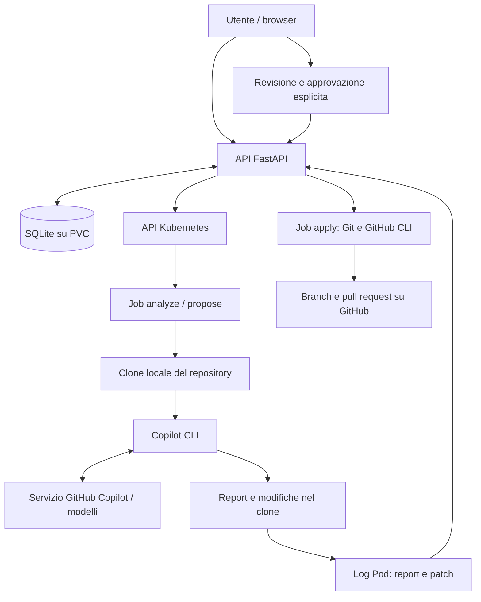
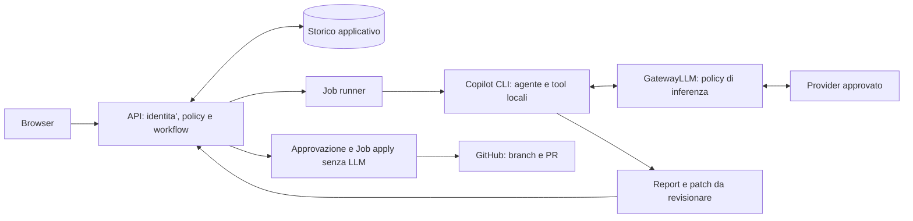

# Resoconto applicativo e valutazione GatewayLLM

Data: 22 ottobre 2026. Stato: base di analisi e proposta, non implementazione.

## 1. Sintesi per la decisione

L'applicativo e' un orchestratore di analisi e proposte di modifica su repository Git, basato su Kubernetes e GitHub Copilot CLI. Non chiama direttamente una generica API di chat e non integra l'estensione Copilot di VS Code.

La scelta dipende da cosa deve governare il GatewayLLM:

| Obiettivo | Posizione utile | Limite principale |
|---|---|---|
| Autorizzare richieste, repository, profili e avvio delle analisi | Applicativo -> gateway applicativo -> runner Copilot CLI | Non vede necessariamente il codice che la CLI legge e invia successivamente al modello |
| Filtrare le singole richieste al modello, governare provider, token e budget | Applicativo -> runner Copilot CLI -> GatewayLLM -> provider LLM | Richiede un'integrazione provider supportata e verificata; puo' cambiare autenticazione, servizio e fatturazione rispetto a GitHub Copilot |
| Conservare il servizio GitHub Copilot e ispezionarne tutto il traffico LLM | Runner Copilot CLI -> gateway compatibile -> servizio GitHub Copilot | Compatibilita' non dimostrata dal progetto; non basta indicare un generico endpoint OpenAI-compatible |

**Raccomandazione:** mantenere nell'applicativo il governo del workflow e dell'approvazione. Se GatewayLLM indica un vero gateway di inferenza, valutarlo tra Copilot CLI e il provider, tramite il supporto BYOK disponibile nella versione scelta della CLI. Se e' obbligatorio conservare il backend GitHub Copilot, prima verificare che il gateway lo supporti ufficialmente: non considerare tale integrazione gia' disponibile.

Le due posizioni non sono alternative assolute: un controllo applicativo all'ingresso e un gateway sul traffico di inferenza coprono confini diversi.

## 2. Componenti attuali

| Componente | Tecnologia / responsabilita' | Evidenza |
|---|---|---|
| Interfaccia web | Pagina HTML/JavaScript, richieste, conversazioni, dettagli, revisione patch e approvazione | [frontend/index.html](frontend/index.html) |
| Backend | FastAPI; validazione input; composizione contesto; creazione Job; lettura risultati; API e file frontend | [backend/main.py](backend/main.py) |
| Archivio | SQLite, percorso configurato `/data/app.db`; richieste, report, patch, commit base, conversazioni, errori e PR | [backend/main.py](backend/main.py#L34) |
| Runner | Bash; clone del repository; invocazione Copilot oppure applicazione patch con Git e `gh` | [runner/run.sh](runner/run.sh) |
| Immagine runner | Node.js 22, pacchetto `@github/copilot`, Git e GitHub CLI | [runner/Dockerfile](runner/Dockerfile) |
| Deployment | Una replica API, Service ClusterIP, PVC locale; namespace e RBAC dedicati | [k8s/app.yaml](k8s/app.yaml), [k8s/namespace-rbac.yaml](k8s/namespace-rbac.yaml) |
| Verifica locale | Test backend con dipendenze simulate e test runner con repository temporanei e CLI finte | [backend/test_requests.py](backend/test_requests.py) |

Ambiente previsto: MVP di sviluppo su WSL2, Docker e kind, accessibile con port-forward locale. Non e' un servizio multiutente pronto per la produzione.

## 3. Flusso attuale



### Analisi e proposta

1. L'utente invia URL HTTPS del repository, task, modalita', profilo agente e skill.
2. Il backend valida host e formato del repository e compone il prompt con istruzioni curate e storico limitato.
3. Il backend crea un Job Kubernetes e salva la richiesta come `running` in SQLite.
4. Il runner esegue un clone shallow del branch predefinito e registra il commit base.
5. In `analyze`, Copilot riceve il divieto di shell e scrittura. In `propose`, riceve il divieto di shell e il permesso di modificare i file del clone.
6. Il runner pubblica report e, per la proposta, patch binaria codificata Base64 nei log del Pod.
7. La lettura del dettaglio richiesta aggiorna stato e risultati interrogando Kubernetes. Non emerge un worker autonomo di raccolta: la persistenza dei risultati dipende da questo percorso di lettura.

### Conversazioni

Ogni follow-up avvia un nuovo clone e una nuova invocazione CLI: non e' il resume di una sessione Copilot. Il contesto comprende al massimo sei turni recenti, con task fino a 4.000 caratteri e report fino a 8.000 caratteri per turno; `build_prompt` limita il contesto storico a 48.000 byte. Questo non e' un limite all'intero traffico LLM: si aggiungono istruzioni, task corrente e dati letti dalla CLI.

I profili `general`, `security`, `reliability` e le skill sono testi applicativi allowlisted, non agenti nativi o plugin arbitrari. Le patch precedenti non vengono riapplicate automaticamente nei cloni dei follow-up.

### Approvazione e PR

L'utente indica un nominativo e un nuovo branch. Il Job `apply` verifica commit base, validita' e assenza del branch remoto, applica la patch salvata, crea commit, push e PR. Non invoca Copilot e non genera una nuova fix. Il controllo del branch usa una lease per impedire la sovrascrittura di un branch creato nel frattempo.

L'approvazione e' esplicita, ma il nominativo e' dichiarato dal chiamante: non equivale a un'identita' autenticata.

## 4. Confine reale dell'integrazione Copilot

L'invocazione si trova nella funzione `run_assistant` del [runner/run.sh](runner/run.sh#L26):

```bash
copilot -p "$PROMPT" -s --no-custom-instructions --disable-builtin-mcps --deny-tool=shell --no-ask-user
```

La modalita' aggiunge `--deny-tool=write` o `--allow-tool=write`. Il prompt viene predisposto da `build_prompt` e trasferito al Job da `job_spec` nel [backend/main.py](backend/main.py#L87).

Implicazioni per il gateway:

- Il backend non costruisce le singole richieste HTTP al modello: e' la CLI a gestire il ciclo agente, letture dei file e successive interazioni LLM.
- Una richiesta utente puo' produrre piu' chiamate al modello. Contare i Job non misura token o consumo effettivo.
- Il repository clonato costituisce un canale di contesto aggiuntivo rispetto al task. Filtrare soltanto il prompt iniziale non garantisce DLP sul codice.
- `-s` restituisce la risposta senza statistiche di utilizzo; l'applicativo non espone contabilita' strutturata di token, modello e costi.
- Nei manifest e nel codice esaminati non sono configurati provider alternativi, GatewayLLM o controlli NetworkPolicy sull'egress.
- Il pacchetto CLI viene installato senza versione esplicita. Disabilitare l'auto-update non rende riproducibili build successive: occorre identificare e fissare la versione prima del PoC.

## 5. Opzione A: gateway prima di Copilot

```text
Applicativo -> gateway applicativo / servizio di esecuzione agente
            -> Job runner -> Copilot CLI -> servizio GitHub Copilot
```

Questa soluzione e' coerente se l'obiettivo e' governare l'accesso all'agente: chi puo' avviare un task, su quali repository, con quali profili, con quali quote di esecuzione e con quale audit.

Per mantenere il comportamento attuale, il servizio deve gestire o delegare esecuzioni asincrone, checkout, permessi dei tool e restituzione degli artefatti. Un gateway che espone solo endpoint di chat non puo' sostituire direttamente la CLI: una risposta testuale non equivale a modificare il clone e produrre una patch.

**Copre:** policy sulle richieste iniziali e sui risultati pubblicati, quote per Job, correlazione e autorizzazione del workflow.

**Non copre da solo:** contenuto di tutte le chiamate interne della CLI, token effettivi, routing dei modelli e blocco preventivo dell'invio di dati letti dal repository. Un filtro sul report finale non annulla un invio gia' avvenuto.

Se serve solo questo livello di governo per l'MVP, alcune responsabilita' possono restare nel backend, senza introdurre subito un nuovo servizio distribuito.

## 6. Opzione B: gateway dopo Copilot CLI

```text
Applicativo -> Job runner -> Copilot CLI -> GatewayLLM -> provider LLM
```

Questa e' la posizione appropriata per un gateway di inferenza: Copilot CLI mantiene il ciclo agente e i tool locali; il gateway media le richieste al modello e le risposte.

La documentazione ufficiale consultata descrive provider BYOK e un registro configurabile tramite `COPILOT_PROVIDERS_CONFIG` / `providers.json`. Questo rende valutabile un endpoint gateway come provider, a condizione che versione CLI, protocollo e modello siano compatibili. Non dimostra la compatibilita' della CLI effettivamente presente nell'immagine locale.

**Distinzione essenziale:** usare l'agente Copilot CLI con un provider personalizzato non equivale necessariamente a usare il servizio di inferenza GitHub Copilot. Credenziali, entitlement, fatturazione e policy del servizio devono essere verificati separatamente.

Il gateway deve supportare il protocollo effettivamente usato, streaming, definizioni dei tool, tool call e relativi risultati, limiti di contesto, errori e cancellazione. La sola etichetta "OpenAI-compatible" non basta a garantire l'intero workflow.

Se invece per "Copilot" si intende il servizio remoto GitHub Copilot, questo progetto non offre un punto per inserire un gateway fra quel servizio e i suoi provider interni. Occorre distinguere tale architettura dal posizionamento dopo la CLI locale.

Un forward proxy aziendale costituisce ancora un caso diverso: il trasporto HTTPS senza ispezione TLS non vede prompt e risposte. Non assumere che l'uso di un proxy di rete realizzi le funzioni di un GatewayLLM.

## 7. Architettura candidata



Il gateway sarebbe un servizio separato, raggiungibile dai runner e non direttamente dal browser. Il backend conserva gestione delle conversazioni, autorizzazioni sui repository, scelta dei profili e approvazione delle patch. Il runner conserva filesystem e raccolta del diff. Il gateway governa il traffico di inferenza, non acquisisce il token di scrittura Git e non approva patch.

Il diagramma rappresenta il candidato BYOK, non una funzionalita' gia' presente. Accessi Git, autenticazione GitHub, eventuali metadati e telemetria sono flussi separati da censire: un endpoint di inferenza personalizzato non prova che ogni connessione della CLI passi dal gateway.

### Superfici da modificare in una futura implementazione

| Superficie | Intervento da valutare |
|---|---|
| `build_prompt` e `launch_request` nel [backend/main.py](backend/main.py) | Identita' verificata, policy applicativa e correlazione richiesta/conversazione/esecuzione |
| `job_spec` nello stesso backend | Configurazione provider approvata, credenziali dedicate e configurazione montata; nessun endpoint arbitrario scelto dall'utente |
| [runner/run.sh](runner/run.sh) | Invocazione provider/modello, gestione errori del gateway e metadati di esecuzione, preservando report e patch |
| [runner/Dockerfile](runner/Dockerfile) | Versione CLI riproducibile e trust TLS aziendale, se necessario |
| [k8s/app.yaml](k8s/app.yaml) e manifest del futuro gateway | Deployment/Service gateway, Secret, connettivita', policy egress e risorse |
| Persistenza backend | Versioni CLI/policy, provider/modello effettivi, correlazione gateway e consumi quando disponibili |
| [backend/test_requests.py](backend/test_requests.py) | Test configurazione Job, negazione policy, indisponibilita' gateway e invarianza dell'approvazione |

Non modificare il percorso `apply` per far rigenerare al modello la patch approvata.

## 8. Vincoli e rischi da tenere presenti

Questa e' un'analisi architetturale preliminare, non un threat model STRIDE/DREAD completo ne' una certificazione di sicurezza.

Asset: codice dei repository, prompt e storico, report e patch, credenziali Copilot/Git, integrita' di branch e PR, disponibilita' del cluster. Confini principali: browser/API; API/Kubernetes; runner/repository non fidato; runner/servizio LLM; approvazione/scrittura Git. Il gateway aggiunge un nuovo confine di fiducia e un possibile archivio di dati sensibili.

- **Identita' e autorizzazioni:** l'API non ha autenticazione utente, autorizzazione per repository o protezione CSRF. Il gateway LLM non risolve questi limiti dell'applicativo.
- **Credenziali:** `WRITE_TOKEN` e' fornito solo ai Job `apply`; attualmente `COPILOT_GITHUB_TOKEN` e `REPO_TOKEN` sono configurati anche per `apply`, pur non essendoci una chiamata Copilot in quel ramo. Nel ridisegno, ridurre i Secret per modalita'. Base64 non e' cifratura.
- **Esfiltrazione e prompt injection:** divieto di shell, istruzioni e MCP disabilitati sono difese parziali, non una sandbox completa. Il gateway puo' applicare controlli sul traffico che lo attraversa, non garantire l'assenza di prompt injection.
- **Egress:** per rendere obbligatorio il gateway occorrono policy di rete effettivamente applicate dal CNI e un inventario delle destinazioni ammesse, incluso clone Git e autenticazione. Non basta impostare una variabile di configurazione.
- **Persistenza:** report e patch transitano nei log Pod e in SQLite. I Job scadono dopo un'ora; manca un audit immutabile e la cancellazione rimuove dati dello storico. Il gateway non deve duplicare indiscriminatamente codice e secret nei propri log.
- **Disponibilita':** i Job hanno deadline di 900 secondi, nessun retry Kubernetes e limiti CPU/memoria, ma non emerge una quota globale di richieste o concorrenza. Il gateway aggiunge latenza e un punto di guasto.
- **Retry:** non ripetere automaticamente l'intero task agente o l'apply su un timeout ambiguo. Distinguere retry della singola inferenza da una nuova esecuzione con possibili effetti e costi aggiuntivi.
- **Osservabilita':** prima di introdurre un gateway soltanto per metriche, valutare il supporto OpenTelemetry documentato dalla CLI, da verificare sulla versione scelta. La telemetria osserva, non impone un controllo preventivo; la cattura dei contenuti richiede policy specifiche.

## 9. Prova discriminante e criteri di accettazione

Ipotesi da verificare: **la versione fissata di Copilot CLI puo' usare il gateway scelto come provider di inferenza, mantenendo letture del repository e produzione della patch senza accesso diretto alternativo all'inferenza.**

Il controllo piu' economico che puo' smentirla e' una singola esecuzione `analyze` su repository sintetico: verificare versione/help provider della CLI, collegarla al gateway e riscontrare nei log correlati la chiamata reale. Un controllo TCP o la sola health del gateway non bastano.

1. Concordare se si deve conservare il servizio GitHub Copilot oppure soltanto l'agente CLI, e quale prodotto/API identifica GatewayLLM.
2. Identificare versione CLI nell'immagine effettiva e fissarla; verificare documentazione provider e contratto del gateway.
3. Provare analisi con lettura di un file sintetico e proposta con modifica reale del clone; controllare report e patch, non solo la risposta finale.
4. Usare un marcatore sintetico non sensibile nel file per verificare che il controllo DLP, se richiesto, agisca prima dell'inoltro al provider. Provare anche la risposta e i risultati dei tool.
5. Bloccare il percorso diretto di inferenza e verificare assenza di bypass; censire separatamente le altre connessioni necessarie.
6. Provare diniego policy, credenziale invalida, 429, timeout, errore upstream e streaming interrotto: stato finale ed errori devono essere visibili senza esposizione di secret.
7. Verificare che gateway indisponibile o policy negata non attivino fallback non autorizzati e non producano una proposta approvabile incompleta.
8. Verificare che il Job `apply` applichi esattamente la patch revisionata senza chiamate LLM, preservando controlli su commit e branch.
9. Confrontare qualita', latenza e consumi con il percorso corrente; non equiparare automaticamente token del provider e addebiti Copilot.

Solo dopo questo PoC e' opportuno scegliere il deployment definitivo e stimare l'intervento.

## 10. Domande aperte

- GatewayLLM e' un prodotto gia' scelto, un proxy aziendale o un servizio da sviluppare? Quali protocolli e upstream supporta?
- E' obbligatorio mantenere abbonamento, modelli e policy del servizio GitHub Copilot?
- La priorita' e' DLP sul codice, audit, identita', budget, routing multi-provider o una combinazione?
- Quali repository e classi di dati possono uscire dall'ambiente? Il gateway deve bloccare, mascherare o soltanto segnalare?
- Il deployment restera' locale o diventera' condiviso? Quali identita', segregazione per team, retention e requisiti di disponibilita' sono previsti?
- Quali metriche e dati di fatturazione sono realmente disponibili con il percorso scelto?

## 11. Evidenze e limiti della verifica

Il resoconto deriva dalla lettura del codice, dei manifest, dei test e del [README.md](README.md). Non sono stati eseguiti deployment, chiamate Copilot reali, verifiche di licenza, test del gateway o test end-to-end. La copertura presente usa anche CLI simulate e non dimostra compatibilita' con un provider reale.

Riferimento ufficiale consultato per le funzionalita' CLI: [GitHub Copilot CLI command reference](https://docs.github.com/en/copilot/reference/copilot-cli-reference/cli-command-reference), sezioni Environment variables, Command-line options e OpenTelemetry monitoring. La documentazione online puo' descrivere funzionalita' diverse da quelle dell'immagine attualmente distribuita.

**Conclusione:** per il controllo dell'inferenza, lo schema da sperimentare e' `Applicativo -> Copilot CLI -> GatewayLLM -> provider LLM`. Per il governo delle richieste applicative, il controllo va prima dell'esecuzione CLI. L'eventuale mantenimento del servizio GitHub Copilot dietro il gateway e' un requisito da provare, non una conseguenza automatica dei due schemi.